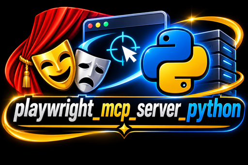

# Playwright MCP Server Python



A **Python** Model Context Protocol (MCP) server that provides browser automation capabilities using [Playwright](https://playwright.dev). This server exposes a set of tools for navigating, interacting with, and extracting data from web pages.

> **Note:** This is an independent, community-maintained Python implementation. It is **not** affiliated with, endorsed by, or derived from [Microsoft's official Playwright MCP server](https://github.com/microsoft/playwright-mcp) (which is a Node.js/TypeScript project using accessibility snapshots). This project uses Playwright's standard Python API directly.

## Features

- **Navigation**: Navigate to URLs, go back/forward, reload pages
- **Interaction**: Click elements, type text, wait for selectors
- **Extraction**: Get text content, page HTML, page title, URL
- **Screenshots**: Take full-page or element screenshots (base64 PNG via MCP resources)
- **Multi-page**: Create and switch between multiple browser pages
- **JavaScript Evaluation**: Execute arbitrary JS in page context

## Installation

Install via pip

```bash
pip install playwright-mcp-server-hellork
```

Or obtain development version from https://github.com/themanyone/playwright-mcp-server-python.git

```bash
git clone https://github.com/themanyone/playwright-mcp-server-python.git
cd playwright-mcp-server-python

# From source
pip install -e .

# Or install with dev dependencies
pip install -e ".[dev]"

# Install Playwright browsers
playwright install chromium
```

## Usage

### As an MCP Server (stdio)

```bash
# Run with default settings (headless chromium)
playwright-mcp

# Run with custom options
playwright-mcp --headed --browser firefox --timeout 60000

# With additional browser args
playwright-mcp --browser-arg "--disable-web-security" --browser-arg "--no-sandbox"
```

### As a Library

```python
from playwright_mcp import create_server, ServerConfig, BrowserConfig

# Custom configuration
config = ServerConfig(
    browser=BrowserConfig(
        headless=True,
        browser_type="chromium",
    ),
    default_timeout=30000,
)

server = create_server(config)
await server.run_stdio()
```

## Available Tools

| Tool | Description |
|------|-------------|
| `navigate` | Navigate to a URL |
| `click` | Click on an element by selector |
| `type` | Type text into an input element |
| `get_text` | Get text content from an element |
| `get_page_content` | Get the current page HTML content |
| `take_screenshot` | Take a screenshot of page or element |
| `new_page` | Create a new browser page |
| `switch_page` | Switch to a different browser page |
| `get_pages` | List all available browser pages |
| `wait_for_selector` | Wait for an element to be visible |
| `evaluate` | Evaluate JavaScript in page context |
| `get_title` | Get the page title |
| `get_url` | Get the current page URL |
| `go_back` | Navigate back in history |
| `go_forward` | Navigate forward in history |
| `reload` | Reload the current page |

## Resources

The server exposes screenshot resources at URIs like `screenshot://{page_id}`.

## Configuration

### BrowserConfig

| Option | Type | Default | Description |
|--------|------|---------|-------------|
| `headless` | bool | `True` | Run browser in headless mode |
| `browser_type` | str | `"chromium"` | Browser engine (chromium, firefox, webkit) |
| `args` | tuple[str] | `()` | Additional browser launch arguments |
| `slow_mo` | float | `0.0` | Slow down operations by ms |
| `devtools` | bool | `False` | Open DevTools on launch |

### ServerConfig

| Option | Type | Default | Description |
|--------|------|---------|-------------|
| `name` | str | `"playwright-mcp"` | Server name |
| `version` | str | `"0.2.0"` | Server version |
| `browser` | BrowserConfig | `BrowserConfig()` | Browser configuration |
| `default_timeout` | float | `30000.0` | Default timeout in ms |

## Development

```bash
# Run tests
pytest

# Type checking
mypy playwright_mcp

# Linting
ruff check playwright_mcp

# Format
ruff format playwright_mcp
```

## Architecture

```
playwright_mcp/
├── config.py       # Configuration dataclasses
├── browser.py      # Browser lifecycle management
├── tools.py        # Tool definitions (MCP schema)
├── executor.py     # Tool execution logic
├── handlers.py     # MCP request handlers
├── server.py       # Main server class
├── cli.py          # Command-line interface
└── __main__.py     # Entry point
```

## Relationship to Other Projects

| Project | Language | Approach | MCP Transport |
|---------|----------|----------|---------------|
| **This project** | Python | Direct Playwright API | stdio |
| [microsoft/playwright-mcp](https://github.com/microsoft/playwright-mcp) | Node.js/TypeScript | Accessibility snapshots | stdio / SSE |
| [microsoft/playwright-cli](https://github.com/microsoft/playwright-cli) | Node.js | CLI + Skills | N/A (CLI) |

## License

Playwright® is a trademark of Microsoft Corporation. This project is an independent implementation using the Playwright Python library under its [Apache 2.0 license](https://github.com/microsoft/playwright/blob/main/LICENSE).

This project includes the Playwright library (also Apache 2.0 licensed by Microsoft Corporation). See [NOTICE](NOTICE) for attribution details.

## Blame

Mostly vibe-coded "from scratch" with [crush agent](https://github.com/charmbracelet/crush) using [NVIDIA: Nemotron 3 Ultra](https://research.nvidia.com/labs/nemotron/Nemotron-3-Ultra/). And without consulting the original Node.js/TypeScript that had no [Fedora](https://fedoraproject.org/) package at the time, and could not be fixed to work with crush. Some bits contributed by themanyone. Examine source code before running. Use at your own risk.

- [Fork this project on GitHub](https://github.com/themanyone/playwright-mcp-server-python)
- YouTube https://www.youtube.com/themanyone
- Mastodon https://mastodon.social/@themanyone
- Linkedin https://www.linkedin.com/in/henry-kroll-iii-93860426/
- Buy me a coffee https://buymeacoffee.com/isreality
- [TheNerdShow.com](http://thenerdshow.com/)

## Thanks for trying out Playwright MCP Server Python!
